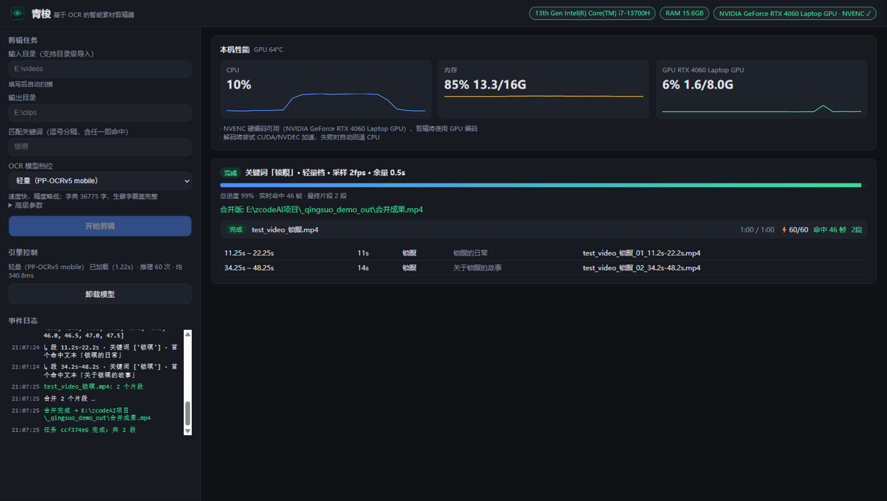
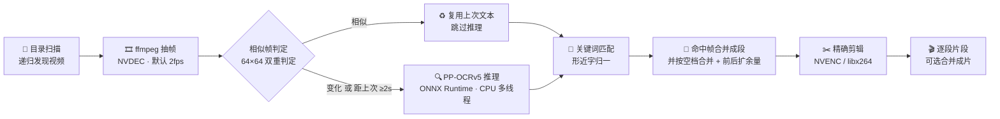

<div align="center">


# 青梭 <sub>QingSuo</sub>

**基于 OCR 的智能素材剪辑器**

*像梭子穿过经纬 —— 给它一个目录和几个关键词，它逐帧认字，把所有出现过这些字的片段剪出来*

[](LICENSE)
[](https://github.com/SrQingChen/QingSuo/releases)
[](#环境要求)
[](#环境要求)
[](https://github.com/SrQingChen/QingSuo/stargazers)
[](https://github.com/SrQingChen/QingSuo/releases)

[]()
[]()
[](#硬件加速)
[](#api)
[]()

</div>

---

## 🎬 这是什么

你需要一个视频里**所有提到了「锁暝」的片段**。手动做法是：拖着进度条从头看到尾，记下时间点，
再一个个裁出来——60 分钟成片，半小时就这么没了。

青梭把这件事变成一次点击：**给它一个目录、几个关键词，它逐帧认字，把命中片段全剪出来。**

抽帧 → OCR → 关键词匹配 → 命中帧合并成段 → 前后留余量 → 帧精确导出。
关键词**直接写在画面上**也照样命中——它认的是像素，不是音轨，所以字幕、贴片、标题卡、
水印里的字**一视同仁**。



<div align="center"><sub>▲ 实际运行截图：关键词「锁暝」在 60s 测试片中命中 46 帧，定位到 11.2–22.2s 与 34.2–48.2s 两段</sub></div>

---

## ✨ 特性

| | 能力 | 实现要点 |
|---|---|---|
| 🎯 | **字幕定位剪辑** | 命中帧按空档合并成段（`merge_gap`），前后扩余量（`margin`，默认 0.5s）并按**半个采样周期**补偿帧时间戳误差，重编码输出保证帧精确 |
| 🔡 | **生僻字完整覆盖** | PP-OCRv5 字典 **36775** 字。PP-OCRv4 只有 13245 字、**不含「暝」**，会把「锁暝」认成「锁的」——选 v5 是刻意决策，不是版本迷信 |
| 🎚️ | **双档模型** | 轻量（mobile，~21MB）/ 高精度（server，~165MB）。换档 = 先卸载再加载，同一时刻只驻留一档，绝不共存 |
| ♻️ | **相似帧跳过** | 64×64 灰度签名**双重判定**，字幕静止时跳过推理；典型字幕场景省 50–80% 推理量且不影响结果 |
| ⏱️ | **绝不漏检的兜底** | `force_ocr_every`（默认 2s）强制重识别——画面再静止，关键词出现后 **≤2s 内必被真实识别** |
| 🩹 | **形近字容错** | 细宋体/低分辨率下「暝↔瞑」混淆率约 5%，匹配时按混淆表归一化，**识别错了也能命中** |
| ⚡ | **硬件加速** | 解码 NVDEC（失败自动回退软解）、编码 NVENC（用 0.2s 黑块**真实试编**探测，而不是只看编码器列表——两者经常不一致） |
| 📈 | **零开销监控** | 后台线程 2s 采样 psutil + nvidia-smi，API 只读内存缓存；前端实时曲线 |
| 🔬 | **逐帧可追溯** | 调试模式逐帧落盘 `logs/debug/{任务id}/{视频名}.jsonl`：时间戳 / 是否跳过 / 推理毫秒 / 识别文本 / 命中关键词 |
| 🧯 | **绝不静默回退** | GPU→CPU 回退、模型缺失、档位冲突全部走事件流明示；"有命中帧却没生成片段"会**显式告警**而非静默返回空 |

---

## 🚀 快速开始

### 0. 免安装版（Windows，不想配环境走这条）

[**⬇️ 下载 QingSuo-1.0.0-win64.zip**](https://github.com/SrQingChen/QingSuo/releases/latest)（约 265MB）
——解压后双击 `QingSuo.exe` 即用，**已内置两档 OCR 模型，无需 Python 环境**；
仍需 FFmpeg 在 `PATH` 中（见下）。想从源码运行见第 1 步起。

### 环境要求

- **Python 3.10+**
- **FFmpeg**：`ffmpeg` 与 `ffprobe` 需在 `PATH` 中（建议使用含 `h264_nvenc` 的构建）
- **NVIDIA 显卡（可选）**：有则启用 NVDEC/NVENC 加速；无则自动回退 CPU，功能不受影响

### 1. 安装依赖

```bash
pip install fastapi uvicorn rapidocr-onnxruntime opencv-python pillow psutil numpy
```

> OCR 走 **onnxruntime CPU 版**（推理线程数 = 逻辑核心数）。刻意不装 `onnxruntime-gpu`：
> 它与 CUDA 版 PyTorch 同装时有冲突风险，而 GPU 算力留给 FFmpeg 的 NVDEC/NVENC 收益更高。

### 2. 准备模型

**轻量档（默认）已随仓库提供**（`models/` 下两个文件，约 21MB），clone 完即可直接运行。

**高精度档**体积合计约 165MB，未入库，按需下载：

```bash
python scripts/fetch_models.py --level accurate   # 从 ModelScope 拉取并校验体积
python scripts/fetch_models.py                    # 或者两档都补齐
```

脚本带体积校验，半截文件不会被当成"就绪"；重复运行会自动跳过已完成的文件。

### 3. 启动

```bat
run.bat                    :: Windows 一键启动
```
```bash
python main.py             # 或直接运行
python main.py --port 9000 --no-browser
```

浏览器自动打开 <http://127.0.0.1:8765>。

### 4. 使用

1. **输入目录**——支持递归子目录 2. **输出目录** 3. **匹配关键词**——逗号分隔，任一命中即剪
4. **选 OCR 档位**——先用轻量档试，小字/低对比度不理想再换高精度
5. **开始剪辑**——实时看进度、命中帧数与逐帧识别文本

---

## 🧠 工作流程



---

## 🩺 两个真实漏检事故（本项目的核心工程价值）

这个工具最容易在"看起来没问题"的地方**静默出错**。以下两个坑都真实发生过，
修复方式直接写进了代码，也是这个项目最值得读的部分。

### 事故一：静止画面里的字幕被"跳过"了

相似帧跳过最初只看**整帧均值差分**。但细笔画字幕在 64×64 降采样后，均值差分**只有 ~0.35**，
远低于阈值 `4.0`——于是"字幕刚刚出现"的那一帧被判定为"和上一帧一样"，整段关键词被跳过，
最终**静默返回零片段**。而运动背景的视频会掩盖这个 bug（背景变化本身就超过阈值），
所以它只在**静止画面**上暴露。

**修复 = 双重判定 + 强制兜底**（`app/jobs.py`）：

- 整帧均值差分（抗噪，阈值 `4.0`）**且**
- 底部 1/3 字幕高发区的"显著变化像素占比"（差值 >25 的像素占比，阈值 `1%`）
  ——实测字幕出现时为 `1.86%`，静止时为 `0%`，区分度极高
- `force_ocr_every`（默认 2s）：距上次真实 OCR 超过该间隔**必定重识别**，
  不依赖任何图像判断。画面再静止，关键词出现后 ≤2s 内必被识别到

> 回归测试请务必用 `test_data/static_videos/`（**静止背景**）——运动背景会掩盖此类 bug。

### 事故二：字认对了，但认成了"隔壁那个字"

极细宋体、无描边、低分辨率下，PP-OCRv5 mobile 会把**「暝」认成「瞑」**——日/目偏旁一字之差，
实测约 5% 场景命中。字认得"很自信"，但关键词匹配静默失败。

**修复 = 形近字容错表**（`app/pipeline/matcher.py`）：匹配前先把混淆字组归一化
（`暝瞑`、`曰日`、`未末`、`己已巳`、`士土`…），组内视为等价。默认开启，可关。

> 附带结论：给字幕加 2px 描边后，轻量档也基本全对；高精度（server）档 15/15 全对。
> 真实字幕几乎都有描边，所以**轻量档在真实素材上通常够用**。

---

## 🎚️ OCR 档位

| 档位 | 模型 | 体积 | 定位 |
|---|---|---|---|
| **轻量**（默认） | `ch_PP-OCRv5_{det,rec}_mobile.onnx` | ~21MB | 速度优先，字典 36775 字覆盖完整；真实带描边字幕基本全对 |
| **高精度** | `ch_PP-OCRv5_{det,rec}_server.onnx` | ~165MB | 检测+识别均为 server 版，小字/低对比度更准，速度约为轻量档的 1/5 |

换档受**双向互斥**保护：推理在飞时拒绝换档，任务运行中拒绝换档与卸载，冲突会明确报错而非抢跑。

---

## 📊 性能参考

实测环境：**i7-13700H / RTX 4060 Laptop / 60s 720p 测试视频**（`test_data/videos/`）

| 档位 | 端到端耗时 | 说明 |
|---|---|---|
| 轻量 | **~24s**（含模型加载） | OCR 约实时 2.5×；单次推理约 340ms |
| 高精度 | ~330s | server 检测+识别，约慢 5.5 倍 |

**相似帧跳过的实际收益**（上面那次真实任务，120 个采样帧）：

```
采样 120 帧 · OCR 60 次（相似跳过 60 · 推理共 19.8s）· 命中 46 帧 → 2 个片段
```

> 调大 `sample_fps`（默认 2fps）可提高定位精度，余量计算已含半采样周期补偿。
> 超过 1920px 的帧会在解码管线内缩放后再送 OCR（OCR 不需要 4K 原图）。

---

## 🧩 架构

```
app/
├── config.py          # 设备探测（只读 DeviceInfo，不加载任何模型）
├── events.py          # 环形事件日志（内存 + 文件双写）
├── monitor.py         # 性能监控采样线程
├── ocr/engine.py      # OCREngine：懒加载 / 卸载 / RLock / busy 计数互斥
├── jobs.py            # JobRunner：后台队列、进度、取消、相似帧跳过
├── pipeline/
│   ├── scanner.py     # 目录扫描
│   ├── sampler.py     # ffmpeg 抽帧（NVDEC + rawvideo 管道 → numpy）
│   ├── matcher.py     # 关键词匹配 + 形近字容错 + 片段合并
│   └── clipper.py     # NVENC 剪辑导出 + concat 合并
├── api.py             # FastAPI 路由
main.py                # 启动入口
web/index.html         # 原生单页前端（零构建、零依赖）
scripts/fetch_models.py # 模型下载与体积校验
models/                # PP-OCRv5 ONNX 权重
```

调度设计借鉴 [IndexTTS 2.5](https://github.com/SrQingChen/IndexTTS-2.5-Pro) 的 `webui_app`
资源调度层，四条约定来自参考项目的实测教训：

1. **单引擎实例 + RLock**：load/unload/换档互斥；**推理本身不加锁**
   （onnxruntime 的 `Run` 线程安全，锁住只会白白浪费多视频并行）
2. **busy 计数双向互斥**：推理在飞时拒绝换档/卸载；任务运行中拒绝换档
3. **同一时刻只驻留一档模型**：8GB 显存下多模型共存必 OOM / 互踩
4. **绝不静默回退**：GPU→CPU、模型缺失、档位冲突都走事件流明示

---

## ⚙️ 高级参数

提交任务时的完整参数（前端「高级参数」面板 / `POST /api/jobs` 均可设置）：

| 参数 | 默认 | 说明 |
|---|---|---|
| `ocr_level` | `fast` | `fast` 轻量 / `accurate` 高精度 |
| `sample_fps` | `2.0` | 抽帧频率（0.2–10），越高定位越准、耗时越长 |
| `margin` | `0.5` | 片段前后保留余量（秒，0–30） |
| `merge_gap` | `1.0` | 命中帧间隔小于此值视为同一段（秒，0–60） |
| `fuzzy_chars` | `true` | 形近字容错（暝↔瞑 等） |
| `ignore_case` | `true` | 忽略英文大小写 |
| `use_regex` | `false` | 关键词按正则表达式解释 |
| `skip_similar` | `true` | 相似帧跳过（字幕静止时省推理） |
| `force_ocr_every` | `2.0` | 强制重识别间隔（秒），防漏检兜底 |
| `fast_copy` | `false` | 快速模式：流复制，秒级完成但**只能落在关键帧上**（非帧精确） |
| `merged_output` | `false` | 额外输出一个把所有片段拼接的合并成片 |
| `recursive` | `true` | 递归扫描子目录 |
| `debug` | `false` | 逐帧调试日志落盘 |

---

## 🔌 API

服务自带 Swagger 文档：<http://127.0.0.1:8765/api/docs>

| 方法 | 路径 | 说明 |
|---|---|---|
| `GET` | `/api/device` | 设备探测结果（CPU / 内存 / GPU / NVENC 可用性） |
| `GET` | `/api/engine` | 引擎状态与统计（档位、加载耗时、推理次数、平均耗时） |
| `POST` | `/api/engine/load` | 换档（受互斥保护） |
| `POST` | `/api/engine/unload` | 卸载模型 |
| `POST` | `/api/jobs` | 提交任务 |
| `GET` | `/api/jobs` · `/api/jobs/{id}` | 任务列表 / 详情（含实时命中帧数） |
| `POST` | `/api/jobs/{id}/cancel` | 取消任务 |
| `GET` | `/api/jobs/{id}/debuglog?file=` | 读取逐帧调试日志（jsonl 尾部） |
| `GET` | `/api/scan?input_dir=` | 预扫描目录 |
| `GET` | `/api/monitor` | 性能快照 + 历史曲线数据 |
| `GET` | `/api/events` | 事件流（内存环形缓冲 + 文件双写） |

---

## 📦 自行打包

想自己构建 Windows 免安装版：

```bash
pip install pyinstaller
pyinstaller --clean --noconfirm QingSuo.spec
```

产物在 `dist/QingSuo/`，双击 `QingSuo.exe` 即用。

构建配置（`QingSuo.spec`）里有两个刻意的选择：**用 onedir 而非 onefile**（包内含
onnxruntime/opencv 原生库与 OCR 权重，onefile 每次启动都要把上百 MB 解压到临时目录，
冷启动慢到无法接受），以及**禁用 UPX**（它会破坏 onnxruntime/opencv 的 DLL）。
另外 uvicorn 的协议/事件循环/生命周期模块全是字符串动态导入，必须逐个列进 `hiddenimports`，
否则打出来的包能启动、一访问就 500。

---

## 📜 许可证

本项目采用 **GPL-3.0** 与 **商业授权** 并行的**双授权**模式：

- **GPL-3.0**（默认）——全文见 [LICENSE](LICENSE)，copyleft：分发修改版须同样以 GPL-3.0 开源
- **商业授权**——希望在不承担 GPL 义务的前提下使用（闭源集成、专有分发），请联系作者另行取得授权

**[NOTICE.md](NOTICE.md)** 载明依据 GPLv3 第 7 条允许的附加条款（保留署名、禁止虚假标示来源、
**「青梭 / QingSuo」名称与标识不在授权范围内**）、第三方组件许可，以及一条重要说明：

> **本项目不使用"最终解释权"作为许可限制。** 单方保留"最终解释权"属于 GPLv3 第 10 条禁止的
> 进一步限制，依第 7 条下游使用者有权移除——它约束不了别人，反而会让分发本身不合规。
> 本项目的原则是：**代码自由，名称保留，解释以文档为准但不得凌驾于 GPLv3 之上。**

---

## 🙏 致谢

- [PaddleOCR](https://github.com/PaddlePaddle/PaddleOCR) / [RapidOCR](https://github.com/RapidAI/RapidOCR)
  —— PP-OCRv5 权重与推理封装（Apache-2.0）
- [IndexTTS 2.5](https://github.com/SrQingChen/IndexTTS-2.5-Pro) —— 单引擎互斥与事件流的调度设计来源
- 以及 FFmpeg、ONNX Runtime、FastAPI 等基础设施

<div align="center"><sub>青梭 · 织出你要的那几秒</sub></div>
